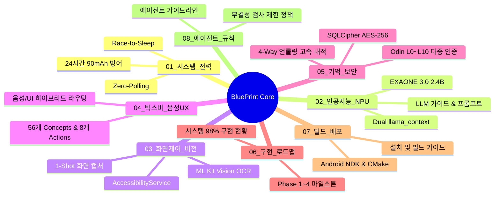
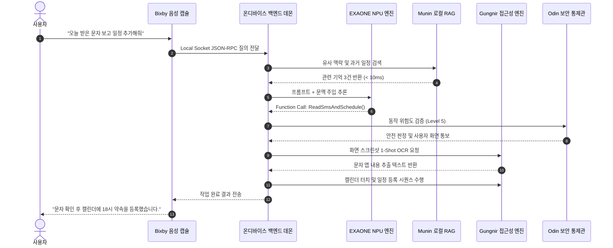

# 🌐 Yggdrasil Master BluePrint (총괄 청사진 인덱스)

> **"클라우드 0원, 데이터 유출 0%, 24시간 실시간 동작하는 세계 최고 수준의 온디바이스 자율 비서"**  
> 본 문서는 위그드라실(Yggdrasil) 프로젝트의 전체 아키텍처, 8대 분야별 청사진 문서 체계, 시스템 결합 구조를 총괄 관제하는 마스터 청사진 허브입니다.

---

## 🧭 8대 분야별 청사진 서브 디렉터리 체계

위그드라실의 모든 세부 설계 사양과 프로젝트 관리 문서는 [`BluePrint/`](file:///c:/Users/nhj23/bixby-workspace/bixby_Yggdrasil/BluePrint) 디렉터리 내의 8대 분야별 전용 폴더로 완벽히 분할·모듈화되어 관리됩니다.

---

## 📂 8대 분야별 섹터 문서 매핑표

| 분류 디렉터리 | 파일명 | 핵심 기술 및 내용 | 문서 바로가기 |
| :--- | :--- | :--- | :---: |
| **`01_시스템_전력/`** | `배터리.md` | • 24시간 90mAh 초저전력 방어 체계 • 모뎀 Tail Time 차단 (Zero-Polling) • 0.4초 초고속 연산 후 동면 (Race-to-Sleep) • Doze Mode 및 One UI 절전 예외 방어 | [배터리.md](file:///c:/Users/nhj23/bixby-workspace/bixby_Yggdrasil/BluePrint/01_%EC%8B%9C%EC%8A%A4%ED%85%9C_%EC%A0%84%EB%A0%A5/%EB%B0%B0%ED%84%B0%EB%A6%AC.md) |
| **`02_인공지능_NPU/`** | `온디바이스_NPU.md` | • LG EXAONE 3.0 2.4B 한국어 특화 가중치 • `ctx_gen` + `ctx_embd` 듀얼 독립 컨텍스트 • Qualcomm QNN & Vulkan NPU 오프로딩 | [온디바이스_NPU.md](file:///c:/Users/nhj23/bixby-workspace/bixby_Yggdrasil/BluePrint/02_%EC%9D%B8%EA%B3%B5%EC%A7%80%EB%8A%A5_NPU/%EC%98%A8%EB%94%94%EB%B0%94%EC%9D%B4%EC%8A%A4_NPU.md) |
| | `ON_DEVICE_LLM_GUIDE.md` | • LLM 모델 파라미터 표준 규격 • GGUF 양자화 및 프롬프트 템플릿 표준 | [ON_DEVICE_LLM_GUIDE.md](file:///c:/Users/nhj23/bixby-workspace/bixby_Yggdrasil/BluePrint/02_%EC%9D%B8%EA%B3%B5%EC%A7%80%EB%8A%A5_NPU/ON_DEVICE_LLM_GUIDE.md) |
| **`03_화면제어_비전/`** | `화면제어_자동화.md` | • Gungnir AccessibilityService 무간섭 터치 • Google ML Kit 로컬 100% 한국어 OCR • VirtualDisplay 1-Shot 온디맨드 캡처 • 물리 전원버튼 비상 인터럽트 Fail-Safe | [화면제어_자동화.md](file:///c:/Users/nhj23/bixby-workspace/bixby_Yggdrasil/BluePrint/03_%ED%99%94%EB%A9%B4%EC%A0%9C%EC%96%B4_%EB%B9%84%EC%A0%84/%ED%99%94%EB%A9%B4%EC%A0%9C%EC%96%B4_%EC%9E%90%EB%8F%99%ED%99%94.md) |
| **`04_빅스비_음성UX/`** | `빅스비_음성_UX.md` | • 빅스비 캡슐 56개 Concepts + 8개 Actions • 200ms 내 음성 즉답 vs 4대 탭 딥링크 전환 • 플로팅 오버레이 HUD 실시간 피드백 | [빅스비_음성_UX.md](file:///c:/Users/nhj23/bixby-workspace/bixby_Yggdrasil/BluePrint/04_%EB%B9%85%EC%8A%A4%EB%B9%84_%EC%9D%8C%EC%84%B1UX/%EB%B9%85%EC%8A%A4%EB%B9%84_%EC%9D%8C%EC%84%B1_UX.md) |
| **`05_기억_보안/`** | `기억_RAG_보안.md` | • Munin SQLCipher AES-256 DB 하드웨어 격리 • 복합 B-Tree 인덱스 + 1,000건 LruCache • 4-Way 루프 언롤링 고속 코사인 유사도 (<12ms) • Odin L0~L10 보안 등급 & Biometric 서명 | [기억_RAG_보안.md](file:///c:/Users/nhj23/bixby-workspace/bixby_Yggdrasil/BluePrint/05_%EA%B8%B0%EC%96%B5_%EB%B3%B4%EC%95%88/%EA%B8%B0%EC%96%B5_RAG_%EB%B3%B4%EC%95%88.md) |
| **`06_구현_로드맵/`** | `구현.md` | • 현재 집중해야 할 온디바이스 4대 과제 • 핵심 실행 대시보드 (Action Items) • *(고정 평가 요구 문구 영구 보존)* | [구현.md](file:///c:/Users/nhj23/bixby-workspace/bixby_Yggdrasil/BluePrint/06_%EA%B5%AC%ED%98%84_%EB%A1%9C%EB%93%9C%EB%A7%B5/%EA%B5%AC%ED%98%84.md) |
| | `아카이브_완료내역.md` | • 기완료된 241개 항목 상세 구현 아카이브 • PART 1 ~ PART 12 전체 명세서 보존 | [아카이브_완료내역.md](file:///c:/Users/nhj23/bixby-workspace/bixby_Yggdrasil/BluePrint/06_%EA%B5%AC%ED%98%84_%EB%A1%9C%EB%93%9C%EB%A7%B5/%EC%95%84%EC%B9%B4%EC%9D%B4%EB%B8%8C/%EC%95%84%EC%B9%B4%EC%9D%B4%EB%B8%8C_%EC%99%84%EB%A3%8C%EB%82%B4%EC%97%AD.md) |
| | `ROADMAP.md` | • Phase 1 ~ Phase 4 마일스톤 계획표 • 릴리스 및 안정화 마일스톤 로드맵 | [ROADMAP.md](file:///c:/Users/nhj23/bixby-workspace/bixby_Yggdrasil/BluePrint/06_%EA%B5%AC%ED%98%84_%EB%A1%9C%EB%93%9C%EB%A7%B5/ROADMAP.md) |
| **`07_빌드_배포/`** | `설치_빌드.md` | • Android NDK, CMake 네이티브 빌드 가이드 • 안드로이드 APK 패키징 및 단말기 배포 지침 | [설치_빌드.md](file:///c:/Users/nhj23/bixby-workspace/bixby_Yggdrasil/BluePrint/07_%EB%B9%8C%EB%93%9C_%EB%B0%B0%ED%8F%AC/%EC%84%A4%EC%B9%98_%EB%B9%8C%EB%93%9C.md) |
| **`08_에이전트_규칙/`** | `android_ondevice_master.md` | • JNI 메모리 안전성 & Zero-ANR 스레드 분리 • 접근성 사용자 우선권 & Sub-Watt 초저전력 코딩 | [android_ondevice_master.md](file:///c:/Users/nhj23/bixby-workspace/bixby_Yggdrasil/BluePrint/08_%EC%97%90%EC%9D%B4%EC%A0%84%ED%8A%B8_%EA%B7%9C%EC%B9%99/android_ondevice_master.md) |
| | `AGENTS.md` | • 프로젝트 전역 상시 전수 검사 금지 원칙 • 제한적 검증 허용 조건 및 행동 수칙 | [AGENTS.md](file:///c:/Users/nhj23/bixby-workspace/bixby_Yggdrasil/BluePrint/08_%EC%97%90%EC%9D%B4%EC%A0%84%ED%8A%B8_%EA%B7%9C%EC%B9%99/AGENTS.md) |
| | `GEMINI.md` | • Gemini 에이전트 행동 가이드라인 | [GEMINI.md](file:///c:/Users/nhj23/bixby-workspace/bixby_Yggdrasil/BluePrint/08_%EC%97%90%EC%9D%B4%EC%A0%84%ED%8A%B8_%EA%B7%9C%EC%B9%99/GEMINI.md) |

---

## 🏗️ 전체 시스템 런타임 데이터 파이프라인

---

## ⚡ 설계 3대 철칙 (Guiding Principles)
1. **Zero-Cloud, Pure On-Device**: 사용자 스마트폰 외부로 1바이트의 음성, 화면, 기억 데이터도 전송하지 않는다.
2. **Sub-Watt Power Efficiency**: 대기 전력 소모를 0에 수렴시키고, 연산 시 NPU의 고효율 가속(`Race-to-Sleep`)을 통해 일상 사용성을 보장한다.
3. **Hardened Local Security**: 최고 수준의 하드웨어 기반 암호화(`StrongBox Keystore`, `AES-256`)와 안드로이드 생체 인증(`BiometricPrompt`)을 결합하여 오작동이나 피싱 위험을 원천 차단한다.
