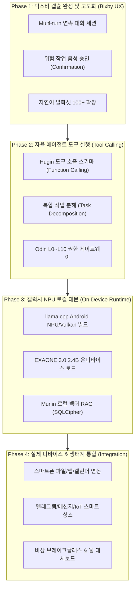

# 🌲 Yggdrasil(이그드라실) 시스템 체계적 개발 로드맵

> **비전**: 갤럭시 S26 울트라 단독 구동, 클라우드 없는 100% 온디바이스 개인화 AI 비서.  
> 외부 데이터 유출 제로(0), 오딘(Odin)의 철저한 L0~L10 보안 통제 하에 자율 행동(Autonomous Agency)을 수행하는 차세대 음성 에이전트 구축.

---

---

## 📌 Phase 1: 빅스비 캡슐 인터랙션 및 UX 고도화 (Bixby UX Complete)
> **목표**: 일방적인 단답형 응답을 넘어, 사용자와 티키타카 연속 대화를 나누고 고위험 행동 시 음성으로 승인을 묻는 대화형 UX 완성.

- [ ] **1. Multi-turn 연속 대화 지원 (`SessionId` & Context Memory)**
  - 대화가 끊기지 않고 *"그 회의 몇 시라고 했지?"*, *"그럼 그때 알림 맞춰줘"* 같은 대명사/문맥 연속 질의 지원
  - 빅스비 `transient` 세션 및 `SessionId` 개념을 활용한 대화 기록 유지
- [ ] **2. 고위험 행동 음성 승인 대화상자 (`Confirmation` / `Authorization`)**
  - L4 이상 작업(송금, 외부 파일 전송 등) 요청 시 빅스비 표준 `confirmation` 뷰 트리거
  - *"5만 원을 이체할까요? [예 / 아니오]"* 음성 승인 후 Gungnir 최종 실행
- [ ] **3. 자연어 학습(NL Training) 대량 확장**
  - 각 Action당 20개 이상의 다양한 구어체 발화 패턴 등록 (사투리, 축약어, 의문형 등 100+ 발화 구축)
- [ ] **4. Bixby Views 모바일 다크 모드 & 인터랙션 최적화**
  - One UI 스타일에 최적화된 테마 색상 및 다이내믹 카드 디자인 완성

---

## 📌 Phase 2: Hugin 자율 에이전트 & 도구 실행 체계 (Tool Calling)
> **목표**: "파일 압축해서 텔레그램으로 보내줘" 같은 복합 명령을 LLM이 스스로 판단해 쪼개고 실행하는 Function Calling 엔진 구축.

- [ ] **1. Hugin Function Calling JSON Schema 정의**
  - 온디바이스 EXAONE 3.0 모델이 호출할 수 있는 도구(Tool) 명세서 구축:
    - `FileCompressTool`: 파일 지정 및 zip 압축
    - `TelegramSendTool`: 메신저 채널 전송
    - `CalendarScheduleTool`: 캘린더 일정 등록
    - `SmartHomeControlTool`: IoT 조명/가전 제어
- [ ] **2. 복합 작업 분해기 (Task Decomposition & Planner)**
  - 단일 문장에서 여러 단계의 하위 작업(Sub-tasks)을 추출하고 순차/병렬 파이프라인 생성
- [ ] **3. Odin L0~L10 런타임 보안 검증기 연동**
  - 계획된 각 하위 작업마다 요구 권한을 대조하고, 미인가 작업은 즉시 인터셉트하여 사용자 승인 큐로 전송

---

## 📌 Phase 3: 갤럭시 S26 울트라 온디바이스 NPU 런타임 구축 (Local Daemon)
> **목표**: PC의 Mock 서버가 아닌, 실제 스마트폰 내부에서 초당 30+ 토큰으로 LLM 추론과 벡터 검색을 100% 로컬 구동.

- [ ] **1. Android 백그라운드 C++ 데몬 (`LocalLlmService`) 구축**
  - `llama.cpp` Android AAR/JNI 라이브러리 탑재
  - 스냅드래곤 8 엘리트 Hexagon NPU 및 Adreno GPU 가속(Qualcomm QNN / Vulkan) 활성화
- [ ] **2. EXAONE 3.0 2.4B GGUF 양자화 모델 배포**
  - 4-bit 양자화(`Q4_K_M`, 약 1.6GB) 모델을 폰 스토리지에 적재하고 백그라운드 RAM 상주(2GB 미만 점유)
- [ ] **3. Munin 온디바이스 로컬 RAG (Vector Search) 엔진**
  - 경량 임베딩 모델(`bge-small-ko-v1.5`, 약 50MB) 기기 내 탑재
  - 기기 내부 SQLCipher 암호화 DB와 벡터 유사도 검색 결합

---

## 📌 Phase 4: 실제 디바이스 & 외부 생태계 통합 (Real-world Integration)
> **목표**: 스마트폰의 실제 기능(파일, 메신저, 결제, IoT)과 물리적으로 연결하여 살아있는 개인 비서 완성.

- [ ] **1. 안드로이드 시스템 프레임워크 연동**
  - `Storage Access Framework`: 폰 내부 문서/사진/다운로드 파일 안전 접근
  - `NotificationListenerService`: 스마트폰 알림 실시간 수집 및 요약
  - `CalendarProvider`: 시스템 캘린더 읽기/쓰기
- [ ] **2. 외부 서비스 통신 모듈 (Alfheim)**
  - 텔레그램 Bot API / 카카오톡 연동
  - MQTT 기반 홈어시스턴트 / 스마트싱스 IoT 기기 연동
- [ ] **3. 비상 방어 및 감사 대시보드 (`temp_yggdrasil/web-dashboard`)**
  - 비상 Break-Glass 모드 발동 시 긴급 차단(Lockdown)
  - 모든 에이전트의 행동과 서명을 기록하는 실시간 감사 로그(Audit Log) 대시보드 연동
